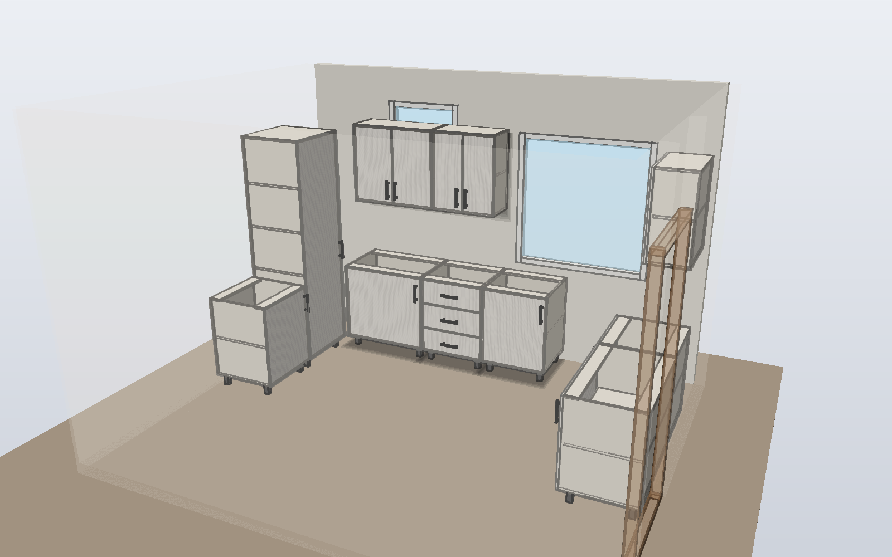
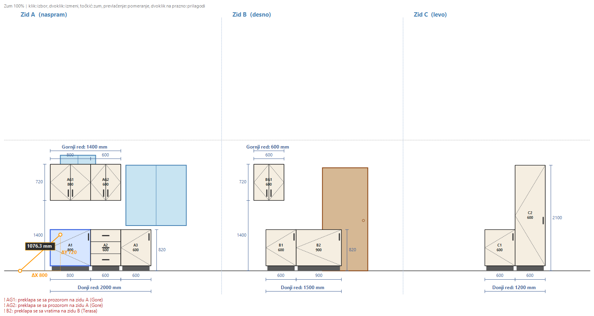
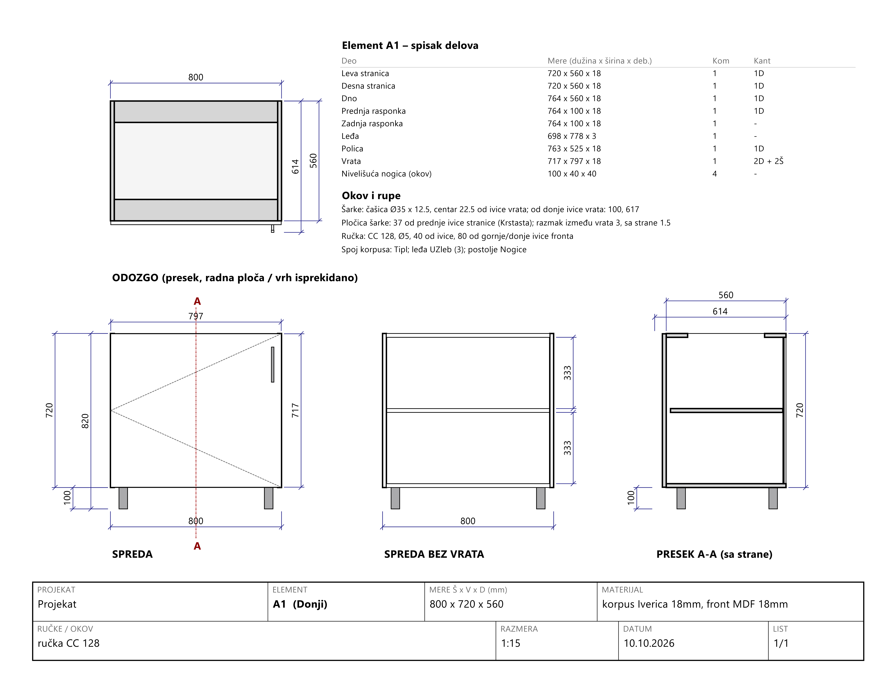
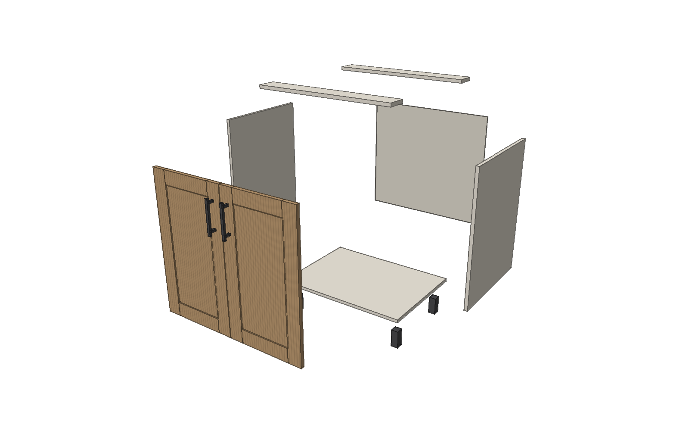
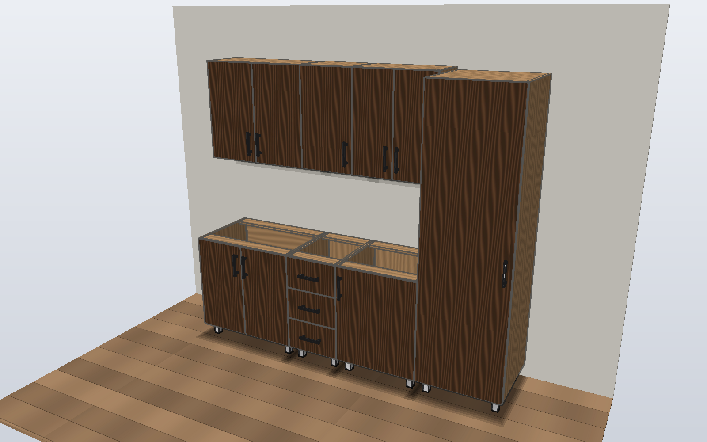
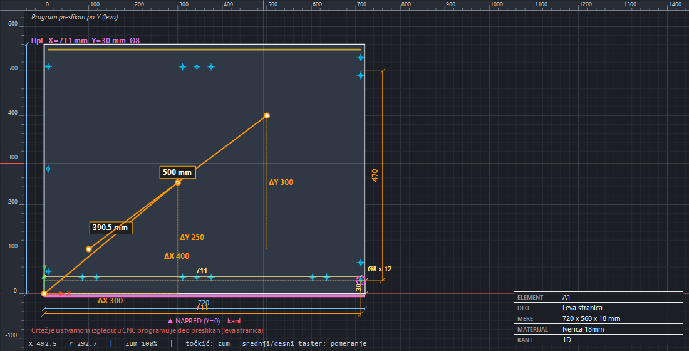

# KuhinjaCAD

Desktop program za Windows za projektovanje kuhinja: od mera prostorije do spiska delova, crteža i CNC programa. Napisan u C# (WinForms), bez spoljnih biblioteka, oko 15.000 linija koda.

Ovde je prikaz projekta. **Izvorni kod je privatan; demo program i uvid u kod dostupni su na zahtev** (vidi ispod).

## Problem koji rešava
U izradi kuhinje iste mere se prepisuju kroz više alata (crtež, lista za sečenje, bušenje, nalepnice), što izaziva greške. KuhinjaCAD drži jedan parametarski model: mera se unese jednom, a svi delovi, rupe za okov, crteži i programi se preračunaju.

## Šta radi
- Projektovanje po zidovima (L i U kuhinje), sa vratima i prozorima prostorije i upozorenjima o preklapanju
- Donji, gornji, visoki elementi i fiokari; korpus, frontovi, okov i spojevi se računaju iz parametara
- Slobodna podela unutrašnjosti, half-joint mreža, wine shelf, slepi ugao, zaobljeni krajevi
- 3D prikaz, eksplodirani prikaz za sklapanje, realistični render (sopstveni path tracer)
- Lista za sečenje, nesting, nalepnice za delove, shop crteži sa kotama
- Izvoz: PDF, DXF (R12 i R2000), CNC programi

## Slike

## Tehnologije
C#, .NET Framework 4, WinForms, GDI+; sopstveni path tracer sa BVH strukturom, nesting algoritam, DXF i PDF izvoz, generisanje CNC programa preko šablona.

## Kako je nastao
Program sam razvila u saradnji sa AI asistentom (Claude Code). Ja sam odredila šta program radi, mere i pravila konstrukcije i proveravala rezultate; asistent je pisao kod po mojim zahtevima.

## Demo i izvorni kod na zahtev
Ako želite da isprobate program ili pogledate kod, javite se na **gudagluposti@gmail.com**. Demo šaljem kao ZIP, a pristup privatnom repozitorijumu dajem samo za čitanje.

## Napomene
- CNC izlaz nije proveren na pravoj mašini.
- Nazivi proizvođača (Blum, Zebra, AutoCAD i dr.) pominju se samo da opišu kompatibilnost.

## Licenca
Sva prava zadržana. Slike i opis su objavljeni radi prikaza portfolija; kod i program se ne smeju kopirati, menjati ni koristiti bez dozvole. Vidi [LICENSE](LICENSE).

Autor: Ivana
